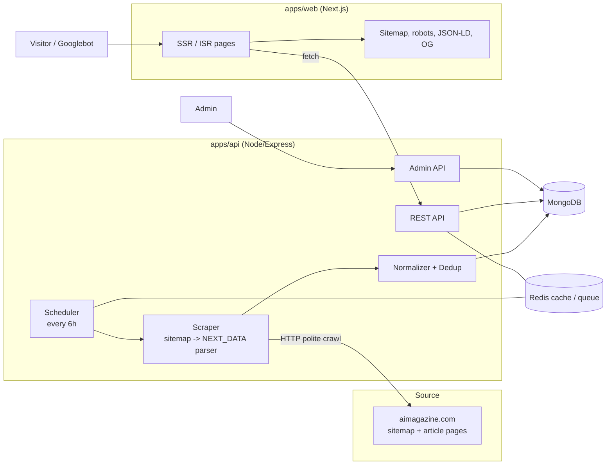
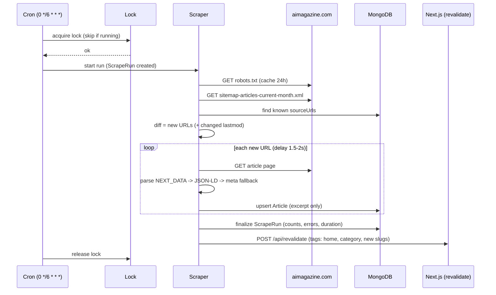
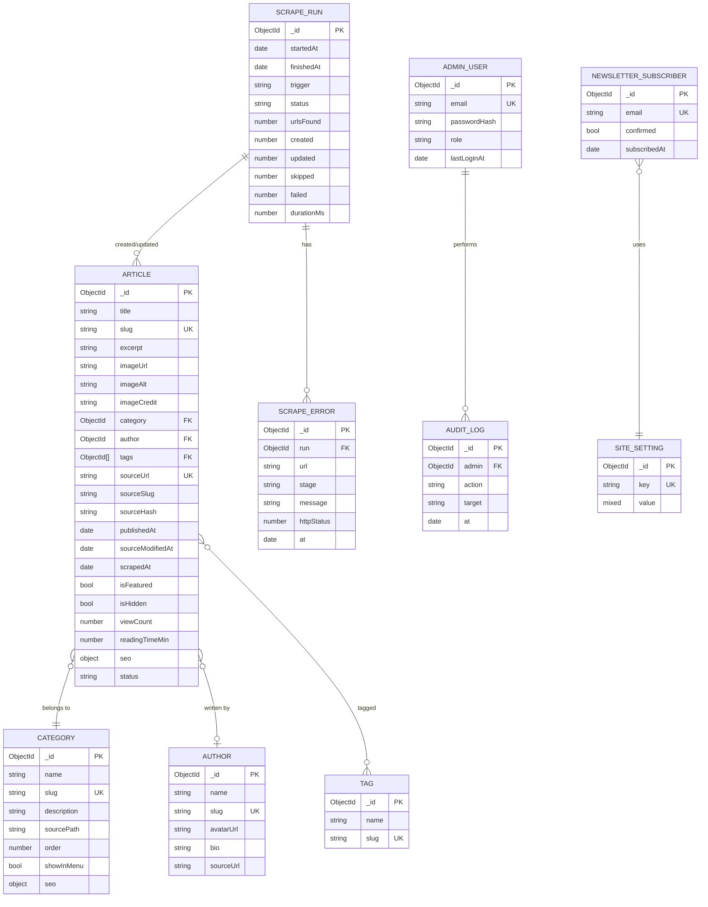
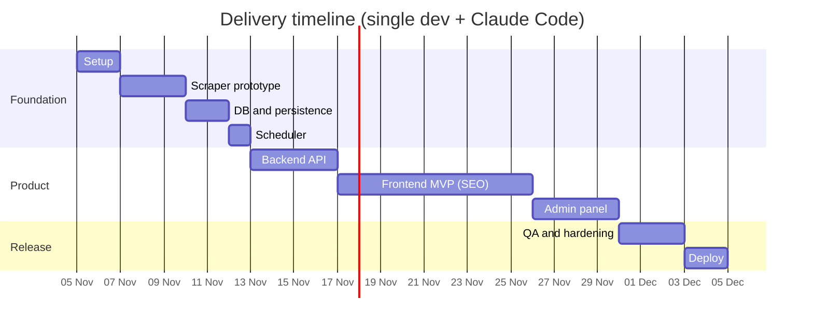

# AI Magazine Clone: Full Plan (MERN + Next.js, SEO-first)

A news/magazine site about AI, **similar in structure but with its own original design and branding**.
Content is aggregated from https://aimagazine.com every 6 hours.

---

## 0. Findings from the source-site check (2026-11-04)

| Item                  | Result                                                                                                                                                                                                  |
| --------------------- | ------------------------------------------------------------------------------------------------------------------------------------------------------------------------------------------------------- |
| robots.txt            | Allows `User-agent: *` for article pages. Disallows: `/search`, `/company/`, `/companies/`, `/executive/`, `/executives/`, `/my-account`, `/thank-you`, `/_next`, `/sites/`, and any URL containing `?` |
| Cloudflare            | Present, but plain HTTP requests return 200. No challenge page                                                                                                                                          |
| Sitemap               | `https://aimagazine.com/sitemap.xml` is an index. Monthly article sitemaps: `sitemap-articles-<M>-<YYYY>.xml` (since 7-2020). Also sections, authors, magazines, video, image-per-category sitemaps     |
| Article sitemap entry | `<loc>`, `image:image` (loc + caption), possibly news tags                                                                                                                                              |
| RSS                   | None (`/feed`, `/rss`, `/rss.xml`, `/feed.xml` all 404)                                                                                                                                                 |
| Site framework        | Next.js. Each page embeds `<script id="__NEXT_DATA__">` JSON (`props.pageProps.latestArticles`, `pageData`, ...)                                                                                        |

**Decision:** discover new URLs through the monthly article sitemap, then read structured data from `__NEXT_DATA__` (fallback: JSON-LD, then meta tags). No headless browser needed.

---

## 1. Legal / ethical guardrails (non-negotiable)

1. Store and display only: **title, short excerpt (max ~200 chars, or the site's own meta description), thumbnail reference, category, author name, publish date, canonical source URL**.
2. **Never store or render the full article body.** Every article page links to the original ("Read full story at AI Magazine") and shows source attribution.
3. Respect robots.txt: no URLs with `?`, none of the disallowed paths. Check the robots rules in code before every fetch.
4. Polite crawling: custom User-Agent with contact email, 1.5-2s delay between requests, concurrency 1, exponential backoff on 429/5xx, stop on repeated failures.
5. Images: do not re-host source images by default. Use the source image URL only if allowed, else a generated placeholder. Add a config flag `IMAGE_MODE=hotlink|placeholder`.
6. Own branding: own name, logo, palette, fonts, copywriting. Layout may be similar, visual identity must not be.
7. Add `/about`, `/privacy`, `/terms`, `/dmca` pages and a visible "Content aggregated from AI Magazine" notice.

---

## 2. Tech stack

| Layer        | Choice                                                       | Why                               |
| ------------ | ------------------------------------------------------------ | --------------------------------- |
| Frontend     | **Next.js 14+ (App Router) + TypeScript + Tailwind**         | SSR/ISR for SEO                   |
| Backend API  | Node.js + Express + TypeScript                               | REST API, scraper host            |
| Database     | MongoDB (Atlas) + Mongoose                                   | MERN                              |
| Scheduler    | `node-cron` (simple) or BullMQ + Redis (retries, visibility) | every 6 hours                     |
| Scraping     | `axios` + `cheerio` (no Playwright)                          | source is server-rendered Next.js |
| Validation   | zod                                                          |                                   |
| Auth (admin) | JWT + bcrypt                                                 |                                   |
| Cache        | Redis (optional) or in-memory LRU                            |                                   |
| Testing      | Vitest/Jest, Supertest, Playwright (a few E2E)               |                                   |
| Deploy       | Docker Compose, Nginx, GitHub Actions, PM2                   |                                   |

Repo layout (monorepo):

```
ai-magazine-clone/
  apps/
    web/        # Next.js frontend
    api/        # Express API + scraper + scheduler
  packages/
    shared/     # shared TS types / zod schemas
  docker-compose.yml
  PLAN.md
  PROMPT.md
```

---

## 3. System architecture



### Scrape pipeline (every 6 hours)



---

## 4. Database design (MongoDB / Mongoose)

### ER diagram



### Indexes

| Collection              | Index                                         | Purpose          |
| ----------------------- | --------------------------------------------- | ---------------- |
| Article                 | `{ sourceUrl: 1 }` unique                     | dedup            |
| Article                 | `{ slug: 1 }` unique                          | page lookup      |
| Article                 | `{ category: 1, publishedAt: -1 }`            | category listing |
| Article                 | `{ isFeatured: 1, publishedAt: -1 }`          | homepage hero    |
| Article                 | `{ isHidden: 1, status: 1, publishedAt: -1 }` | public queries   |
| Article                 | text index on `title`, `excerpt`              | search           |
| Article                 | `{ tags: 1, publishedAt: -1 }`                | tag pages        |
| Category / Author / Tag | `slug` unique                                 |                  |
| ScrapeRun               | `{ startedAt: -1 }`                           | admin log list   |
| ScrapeRun               | TTL index on `startedAt` (90 days)            | auto-clean       |

Notes:

- `sourceHash` = hash of (title + excerpt + image + modified date). Re-save only if it changed.
- `slug` is generated from title; on collision append a short suffix. Keep `sourceSlug` for traceability.
- `seo` sub-document: `{ metaTitle, metaDescription, canonicalUrl, ogImage, noindex }`.
- `status`: `published | hidden | failed-parse`.

---

## 5. SEO plan (Next.js)

| Area                   | Implementation                                                                                                                                          |
| ---------------------- | ------------------------------------------------------------------------------------------------------------------------------------------------------- |
| Rendering              | ISR with `revalidate` (e.g. 300s) plus on-demand revalidation after each scrape run                                                                     |
| URLs                   | `/` , `/category/[slug]`, `/article/[slug]`, `/tag/[slug]`, `/author/[slug]`, `/search` (noindex)                                                       |
| Metadata               | `generateMetadata` per page: title, description, canonical, robots                                                                                      |
| Open Graph / Twitter   | og:title/description/image, `twitter:card=summary_large_image`                                                                                          |
| Structured data        | JSON-LD: `NewsArticle` (with `isBasedOn` / source link), `BreadcrumbList`, `Organization`, `WebSite` + `SearchAction`                                   |
| Sitemaps               | `/sitemap.xml` (index) + paginated article sitemaps + **news sitemap** (last 48h); generated from DB                                                    |
| robots.txt             | allow all public pages, disallow `/admin`, `/api`, `/search`                                                                                            |
| Performance            | `next/image`, font optimization, lazy load, minimal JS, target Lighthouse 90+ and good Core Web Vitals                                                  |
| Canonical / duplicates | canonical points to our own page; pages carry rel="nofollow noopener" style attribution link to source where appropriate                                |
| Internal linking       | related articles, category and tag hubs, breadcrumbs                                                                                                    |
| Other                  | pagination with `rel` handled via clean paths (`/category/x/page/2`), 404 and 410 handling for removed articles, RSS feed of our own site (`/feed.xml`) |

---

## 6. API design

Public:

- `GET /api/articles?category=&tag=&author=&page=&limit=&sort=`
- `GET /api/articles/:slug`
- `GET /api/articles/:slug/related`
- `GET /api/home` (hero, featured, latest, per-category blocks in one call)
- `GET /api/categories`, `/api/tags`, `/api/authors/:slug`
- `GET /api/search?q=`
- `GET /api/trending`
- `POST /api/newsletter`
- `POST /api/revalidate` (secret header, internal)

Admin (JWT):

- `POST /api/admin/login`
- `GET/PATCH/DELETE /api/admin/articles` (hide, feature, edit SEO)
- `GET /api/admin/scrape-runs`, `POST /api/admin/scrape-runs` (manual run)
- `GET /api/admin/stats`

Cross-cutting: zod validation, helmet, CORS allowlist, rate limiting, central error handler, structured logging (pino).

---

## 7. Frontend pages and components

Pages: Home, Category, Article, Tag, Author, Search, About, Contact, Privacy, Terms, DMCA, 404; Admin (separate `/admin` area).

Home layout (original design, similar structure): top bar, sticky header with mega menu, hero + featured grid, "Latest" list, per-category sections, trending sidebar, newsletter block, footer.

Components: Header, MegaMenu, ArticleCard (variants: hero, large, small, list), CategorySection, Pagination, Breadcrumbs, NewsletterForm, SearchBox, Skeletons, SourceAttribution, ShareButtons, ThemeToggle (optional).

Design: own brand name and logo, own palette, own fonts, accessible contrast, responsive mobile-first.

---

## 8. Phases and tasks

### Phase 0: Setup (1-2 days)

- [x] Init monorepo (pnpm workspaces), TypeScript, ESLint, Prettier, Husky
- [x] Docker Compose: mongo, redis
- [x] `.env.example`, config module, logger
- [x] README with run instructions

### Phase 1: Scraper prototype (2-3 days) **<- do this first**

- [x] robots.txt fetcher and path checker
- [x] Sitemap reader (index -> current and previous month article sitemaps)
- [x] Article page fetcher with delay/retry/backoff
- [x] `__NEXT_DATA__` parser with JSON-LD and meta fallbacks
- [x] Normalizer to Article shape (excerpt trimming, slug, category, author)
- [x] Save sample HTML fixtures and write parser unit tests
- [x] CLI: `pnpm scrape:once --limit 20` prints results
- [x] **Gate:** if blocked or data is unusable, stop and report before building more

### Phase 2: Database and persistence (1-2 days)

- [x] Mongoose models, indexes, seed (categories)
- [x] Upsert with dedup and `sourceHash`
- [x] ScrapeRun and ScrapeError logging
- [x] Backfill command (`--since 2026-01`)

### Phase 3: Scheduler (1 day)

- [x] Cron `0 */6 * * *`, overlap lock, graceful shutdown
- [x] Retry and failure alert (email or webhook)
- [x] Manual trigger endpoint
- [x] Revalidation call to Next.js after each run

### Phase 4: Backend API (3-4 days)

- [x] All public endpoints, search, related, trending
- [x] Caching, rate limit, validation, error handling
- [x] API tests (Supertest)

### Phase 5: Frontend MVP, SEO-first (7-9 days)

- [x] Design tokens, layout, header/footer/mega menu
- [x] Home, Category, Article, Tag, Author, Search, static pages
- [x] Metadata, JSON-LD, sitemaps, robots, OG images, own RSS
- [x] ISR plus on-demand revalidation
- [x] Responsive pass, accessibility pass, Lighthouse pass

### Phase 6: Admin panel (3-4 days)

- [x] Login, dashboard stats, article moderation, scrape run table, manual run

### Phase 7: QA and hardening (2-3 days)

- [ ] E2E tests, selector-break detection and alerting
- [ ] Security review (headers, rate limits, auth)
- [ ] DB/query performance review

### Phase 8: Deploy (2 days)

- [ ] Dockerfiles, Nginx, SSL, CI/CD
- [ ] Monitoring (Sentry, uptime), Mongo backups
- [ ] Submit sitemap to Google Search Console

### Timeline



Estimate: about 4 weeks of active work (scraper shorter than first estimated). Token budget: roughly 4-6M total (input + output with caching), output alone about 0.4-0.7M.

---

## 9. Risks

| Risk                              | Mitigation                                                                                                  |
| --------------------------------- | ----------------------------------------------------------------------------------------------------------- |
| Source changes HTML or JSON shape | Layered parsers (NEXT_DATA -> JSON-LD -> meta), fixture tests, failure alert                                |
| Source blocks the crawler         | Stay polite, low volume; if blocked, stop and contact the site for permission or a feed                     |
| Copyright complaint               | Excerpt-only, attribution, DMCA page, takedown flow in admin                                                |
| Duplicate-content SEO penalty     | Original design/copy, short excerpts, canonical to our own pages, add original value (categories, curation) |
| Cron overlap or crash             | Lock, idempotent upserts, run log                                                                           |
