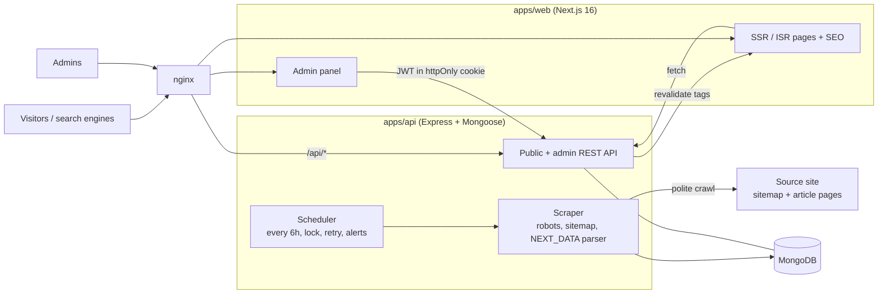

# Synthwire: an AI news site and magazine CMS

[](https://github.com/alkafi1/ai-magazine-clone/actions/workflows/ci.yml)
[](LICENSE)

A full-stack news site built with **Next.js, Express and MongoDB**. It does two things:

1. **Aggregates AI headlines** from a source site every 6 hours (headline, short excerpt, picture link, category,
   author, date, and a link back). It never copies full article text.
2. Is a small **magazine CMS**: write your own articles, make categories and pages, change the logo, menus and
   theme, run ads, and manage a team with roles, all from an admin panel with no redeploy.

The default brand is "Synthwire" and the default source is [aimagazine.com](https://aimagazine.com). Both are
configurable. See [Legal and ethics](#legal-and-ethics) before pointing it at any site.

> Planning notes: [PLAN.md](PLAN.md) (original scope, data model, SEO plan). Going live: [docs/DEPLOYMENT.md](docs/DEPLOYMENT.md).

## Contents

[Features](#features) · [Architecture](#architecture) · [Quick start](#quick-start) · [Configuration](#configuration) ·
[Admin, roles and content](#admin-roles-and-content) · [Themes](#themes) · [Ads, consent and analytics](#ads-consent-and-analytics) ·
[SEO](#seo) · [Scraper](#scraper) · [API](#api) · [Testing](#testing) · [Security](#security) · [Operations](#operations) ·
[Project layout](#project-layout) · [Legal and ethics](#legal-and-ethics) · [License](#license)

## Features

**Public site**

- Server-rendered with ISR plus on-demand revalidation; home, latest, categories, topics, tags, authors, search, article
  pages, custom pages, RSS (site and per category), dark mode, announcement bar, newsletter sign-up.
- **Reader experience**: Reading progress bar, adjustable text size, text-to-speech audio reader, article bookmarking / saved articles, local comments, and PWA offline support with web manifest.
- **3 themes**, switchable from the admin: _Synthwire_ (editorial), _Broadsheet_ (newspaper), _Midnight_ (dark tech).
- Accessible (axe WCAG 2 A/AA checks run on every page, every theme, light and dark) and fast (Lighthouse 94 to 99
  with the image optimizer on).

**Admin panel** (`/admin`)

- Dashboard with charts and scraper health; article moderation with **bulk actions**; write **original articles**
  (markdown, preview, drafts, scheduling, cover images); categories; pages; media library.
- **RBAC**: 6 built-in roles plus **custom roles** with a permission picker, ranks and a privilege-escalation guard;
  account lockout, immediate session invalidation, **audit log**.
- **Ads** (Google AdSense or any network) with a consent banner, GA4, `ads.txt`, and a Content-Security-Policy that follows
  your settings.
- Branding: logo, favicon, name, tagline, menus, theme. Create/edit forms open in modals.

**Content pipeline**

- Polite crawler: obeys robots.txt, 1.5 to 2 s between requests, one request at a time, backoff, stops on repeated 403/429.
- Per-run report in the admin: what was new, updated or failed, with warnings when the source's markup changes.

## Architecture



| Layer    | Choice                                                              |
| -------- | ------------------------------------------------------------------- |
| Frontend | Next.js 16 (App Router), React 19, Tailwind CSS 4, TypeScript       |
| API      | Node.js 22, Express 5, TypeScript, zod 4, pino                      |
| Database | MongoDB 7 with Mongoose                                             |
| Auth     | JWT (HS256) + bcrypt, httpOnly SameSite=Strict cookie for the admin |
| Tests    | Vitest, Supertest, Playwright, axe-core                             |
| Delivery | pnpm workspaces, Docker Compose, nginx, GitHub Actions              |

## Quick start

Requires Docker. For local development also Node 20+ and pnpm.

### Run everything in Docker (production-like)

```bash
cp .env.example .env     # set JWT_SECRET, REVALIDATE_SECRET (32+ random chars) and SCRAPER_CONTACT_EMAIL;
                         # delete the COMPOSE_FILE line
docker compose up -d --build
docker compose exec api node dist/db/create-admin.js you@example.com 'a-long-password'
docker compose exec api node dist/scraper/run-cli.js --limit 20      # first articles (6-hourly schedule is already on)
open http://localhost:8080                                           # the site; /admin is the admin panel
```

Generate a secret with `openssl rand -base64 48 | tr -d '\n=/+' | head -c 48`. Services: `mongo`, `api`, `web`, `nginx`
(the only published port). HTTPS: `docker-compose.tls.yml` (see [docs/DEPLOYMENT.md](docs/DEPLOYMENT.md)).

### Develop locally

```bash
pnpm install
cp .env.example .env     # keeps COMPOSE_FILE=docker-compose.yml:docker-compose.dev.yml (publishes Mongo on :27017)
docker compose up -d mongo
pnpm --filter @aimag/shared build
pnpm --filter @aimag/api dev          # API and scheduler on :4000
pnpm --filter @aimag/web dev          # site on :3100
pnpm --filter @aimag/api create-admin you@example.com 'a-long-password'
```

| Command                                                  | What it does                                                                                                                      |
| -------------------------------------------------------- | --------------------------------------------------------------------------------------------------------------------------------- |
| `pnpm test`                                              | Unit and API tests (needs MongoDB)                                                                                                |
| `pnpm e2e`                                               | Playwright against an isolated stack (own DB, own ports). First time: `pnpm --filter @aimag/web exec playwright install chromium` |
| `pnpm lint` / `pnpm typecheck` / `pnpm format`           | Quality checks (also run on staged files by the pre-commit hook)                                                                  |
| `pnpm scrape:once --limit 20`                            | Dry run: scrape and print, no database                                                                                            |
| `pnpm --filter @aimag/api scrape --limit 30 [--refresh]` | Real run into MongoDB                                                                                                             |
| `pnpm --filter @aimag/api backfill 2026-01`              | Import every month since a given month                                                                                            |
| `pnpm --filter @aimag/api db:explain`                    | Query-plan review on ~30k synthetic articles                                                                                      |
| `./scripts/backup-mongo.sh` / `restore-mongo.sh`         | Compressed dump with rotation, and restore                                                                                        |

## Configuration

Everything is configured through environment variables, validated with zod at start-up
(`apps/api/src/config`). See [.env.example](.env.example) for the full list. The important ones:

| Variable                                   | Purpose                                                                                                 |
| ------------------------------------------ | ------------------------------------------------------------------------------------------------------- |
| `JWT_SECRET`, `REVALIDATE_SECRET`          | Random strings, 32+ characters. **The API refuses to start in production with weak or default values.** |
| `SITE_URL`                                 | Public URL of the site (baked into the web build: rebuild after changing)                               |
| `SCRAPER_BASE_URL`, `SCRAPER_SECTIONS`     | Source site and which sections to import (default `news,articles`)                                      |
| `SCRAPER_CONTACT_EMAIL`                    | Shown to the source site in the crawler's User-Agent. Use a real, monitored address                     |
| `SCHEDULER_ENABLED`, `SCHEDULER_CRON`      | The 6-hourly run (default `0 */6 * * *`)                                                                |
| `ALERT_WEBHOOK_URL`                        | Optional Slack/Discord/other webhook for failures and "source format changed" alerts                    |
| `IMAGE_MODE`, `IMAGE_OPTIMIZE`             | Hotlink source images or let Next cache resized WebP copies (see [Legal](#legal-and-ethics))            |
| `TRUST_PROXY_HOPS`, `LOGIN_RATE_LIMIT_MAX` | Reverse-proxy depth and sign-in attempts per IP per 15 min                                              |

## Admin, roles and content

Sign in at `/admin`. Create the first account with `create-admin` (a **super admin**); add everyone else under Users.

| Area                     | What it does                                                                       |
| ------------------------ | ---------------------------------------------------------------------------------- |
| Dashboard                | KPIs, stories-per-day chart, scraper health, "attention needed" alerts             |
| Articles                 | Search/filter, bulk feature/hide/restore, takedown, SEO overrides, **New article** |
| Categories, Pages, Media | Content structure, custom pages (`/p/<slug>`), image library                       |
| Scrape runs              | History, per-run details (new / updated / failed), warnings, **Run now**           |
| Appearance               | Logo, name, tagline, favicon, header and footer menus, **theme**                   |
| Ads, Site settings       | Ad network and placements, announcement bar, social links, GA4, feature toggles    |
| Users, Roles, Audit log  | Accounts, custom roles, who did what and when                                      |

**Two kinds of article.** _Aggregated_ stories hold only headline, short excerpt, picture link, category, author, date
and the source URL; the API never returns a body for them, whatever is in the database (tested). _Original_ articles
are written in the admin (markdown), have their own full page, and no source box.

**Roles.** Permissions, not role names, are checked everywhere (`packages/shared/src/rbac.ts`); the API enforces them and
the UI only hides what you cannot use.

| Role        | Can do                                              |
| ----------- | --------------------------------------------------- |
| Super admin | Everything, including managing other super admins   |
| Admin       | Everything except managing super admins             |
| Editor      | Write and feature articles, edit SEO, upload images |
| Moderator   | Hide, restore and take down stories                 |
| Ad manager  | Dashboard and ads                                   |
| Viewer      | Read-only                                           |
| _Custom_    | Any set of the 20 permissions at a rank you choose  |

You can only grant permissions you hold, only at a rank below your own, and only manage accounts ranked below you.
Role, password and disable changes take effect on the user's very next request; five wrong passwords lock an
account for 15 minutes.

## Themes

Switch the whole public site in Admin → Appearance: **Synthwire** (default), **Broadsheet** (cream paper, red accent,
serif type, centred masthead, square corners), **Midnight** (dark-first, cyan accent, glowing cards). A theme is a block
of CSS variables in `apps/web/src/app/globals.css` (`html[data-theme='…']`). To add one, copy a block and add its name to
`THEMES` in `packages/shared/src/settings.ts`.

## Ads, consent and analytics

Admin → Ads: choose Google AdSense (publisher ID and slot IDs) or paste another network's code, enable the placements
(header, in-feed, sidebar, article top/bottom). Ads and GA4 load **only after the visitor accepts** the cookie banner;
`/ads.txt` is generated from your settings; the CSP allows exactly the hosts you enable. The built-in banner is basic:
Google requires a certified consent platform for personalised ads to EU/UK/CH visitors. You need your own AdSense account.

## SEO

`generateMetadata` and canonical URLs on every page; Open Graph and Twitter cards with a generated branded image
(`/og/<slug>`); JSON-LD `NewsArticle`, `BreadcrumbList`, `Organization`, `WebSite`+`SearchAction`; sitemap index with paginated
article sitemaps and a news sitemap; robots.txt; RSS; clean pagination paths; real HTTP **410** for taken-down stories.

## Scraper

Discovery reads the source's monthly article sitemaps (computed from the date because the source's index omits them),
falls back to the homepage's latest stories, then reads each page's embedded `__NEXT_DATA__`, then JSON-LD, then meta tags.
A run finding zero URLs fails and alerts; falling back to weaker parsers is flagged as a warning, so a source redesign is
noticed early. Upserts are idempotent (unique `sourceUrl`, change detection by `sourceHash`); slugs are made unique by a
URL-derived suffix; scheduled runs use a Mongo lock, retries with backoff, and shut down gracefully.

## API

REST under `/api`, validated with zod, cached, rate limited, with a CORS allow-list and helmet.
Public: `GET /articles`, `/articles/:slug`, `/home`, `/categories`, `/tags`, `/authors/:slug`, `/pages/:slug`, `/search`, `/trending`, `/site-config`, `POST /newsletter` …
Admin (`Authorization: Bearer <jwt>`): `/admin/articles`, `/categories`, `/pages`, `/media`, `/users`, `/roles`, `/settings/*`,
`/scrape-runs`, `/audit`, `/stats`. Responses and error shapes are covered by the Supertest suite.

## Testing

| Suite                          | Count | What                                                                                                                    |
| ------------------------------ | ----- | ----------------------------------------------------------------------------------------------------------------------- |
| API / unit (Vitest, Supertest) | ~150  | RBAC matrix, custom roles, content, scraper parsers, pipeline, security                                                 |
| Web unit                       | 7     | URL/paging helpers, JSON-LD                                                                                             |
| End-to-end (Playwright)        | 75    | Public flows, admin flows, roles, themes, **axe accessibility matrix** (3 themes x light/dark), site-wide quality crawl |

GitHub Actions ([ci.yml](.github/workflows/ci.yml)) runs format, lint, typecheck, unit tests, E2E, `pnpm audit` and the Docker builds.

## Security

Input validated with zod everywhere; operator injection ignored; only `https` URLs stored; the scraper refuses other hosts
and redirects; uploads are content-sniffed and served with a sandboxing CSP; admin session in an httpOnly SameSite=Strict cookie;
helmet, per-request CSP, rate limits (public, login, newsletter), audit log, CSV-export formula-injection protection;
production refuses weak secrets. Report vulnerabilities privately (see [SECURITY.md](SECURITY.md)).

## Operations

Docker Compose stack with healthchecks and log rotation; nginx with security headers and a TLS override; MongoDB backup and
restore scripts; Dependabot; weekly CI audit. MongoDB needs a high open-files limit (the compose file sets it).
Details, the go-live checklist and troubleshooting: [docs/DEPLOYMENT.md](docs/DEPLOYMENT.md).

## Project layout

```
apps/api         Express API, scraper, scheduler, publisher, models, tests
apps/web         Next.js frontend and admin panel, Playwright E2E
packages/shared  zod schemas, RBAC definitions and settings shared by both
nginx/           reverse-proxy configs (HTTP and TLS template)
scripts/         Mongo backup and restore
docs/            DEPLOYMENT.md
```

## Legal and ethics

This project **aggregates headlines** from a third-party publisher. Before running it against any site you do not own:

- Ask the publisher for permission. Their robots.txt allowing crawling is not a licence.
- Keep to the defaults: short excerpt, picture link, attribution and a link to the original on every story; never copy bodies.
- Use a real `SCRAPER_CONTACT_EMAIL` so the publisher can reach you, and keep the crawl rate low.
- `IMAGE_OPTIMIZE=true` makes your server cache resized copies of their images; leave it off unless you have permission.
- Provide a working takedown route (the DMCA page and the admin takedown action are built in).

This project is not affiliated with, endorsed by or sponsored by aimagazine.com or BizClik. Search engines may treat a site
of headlines and summaries as thin content; the original articles, categories and pages you add are what make it worth indexing.
Check the name "Synthwire" for trademark conflicts before using it publicly, or change it in Admin → Appearance.

## License

[MIT](LICENSE). The licence covers the code, not the content of any site it aggregates.
